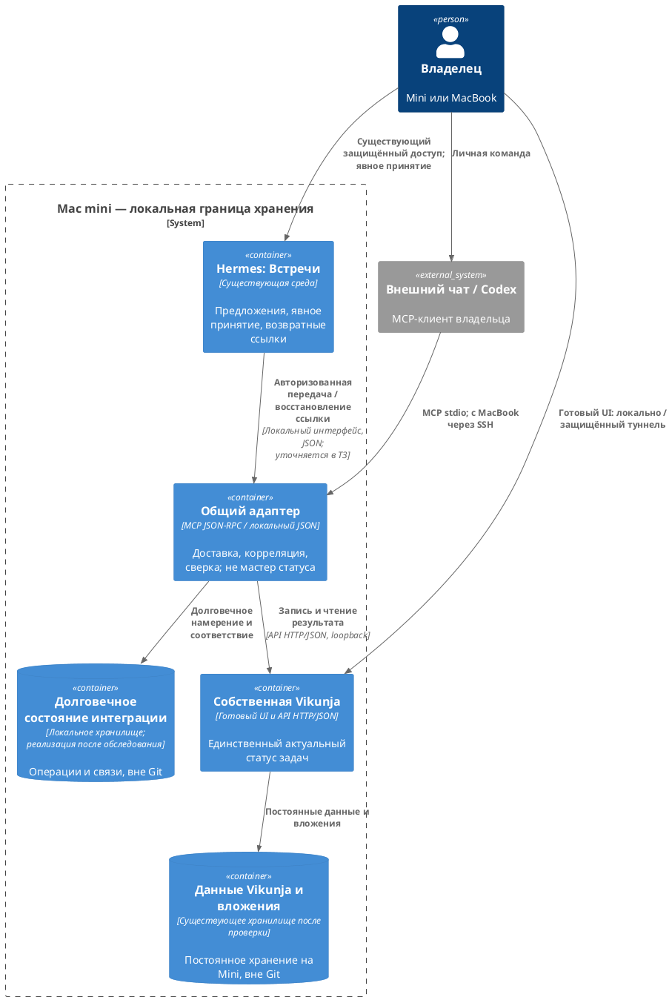

# EA-010 — единый локальный адаптер чата и «Встреч» к Vikunja на Mac mini

## Ссылки

- [Принятые бизнес-требования: BR-01–18 и AC-01–18](../artifacts/t_606468bd-business-requirements.md).
- [Состояние процесса t_606468bd](../process/t_606468bd.md); поручение `t_9cf02024`, шаг `architecture-design`, роль `ai-architect`.
- [Нефункциональные требования этого решения](../requirements/t_606468bd-nfr.md).
- [README сервиса](../../README.md); репозиторий: https://github.com/iefimov1008/vikunja-local.
- Полная замороженная постановка: `/Users/efimovivan/Documents/DevProjects/intake/vikunja-local-ea010-install-integration-task.md`.

**Редакция и полномочия.** Версия 1.0, локальный черновик на человеческую приёмку, не принятая архитектура и не отчёт об установке. SHA256 постановки проверен: `b5127175403c077884d3d1de00e445fd7cabbab13718024c00a4d1b4027b4165`; SHA256 БТ: `31648614925c5542f0b588d715586219fbe168b505452c802f0f663fcf344f9b`. БТ приняты `iiefim10` по записи `approved` в process-state, несмотря на сохранённую историческую надпись «Не принято» в тексте БТ. Гейт `requirements-gate` имеет `passed`. Native planner с реестром `/Users/efimovivan/Projects/cto-agent-environment/ops/real/process-profile-staged` разрешает `architecture-design`, `blocked_by` и `external_inputs` пусты, drift отсутствует (`65dc5c6854ff`).

Локальный паспорт разрешён ответом `51a10b71-4bda-4b92-8da8-7eb23a46ac4f` на вопрос `ea010-architecture-adr-passport-01`: идентификатор проекта вместо PPInfo, `iiefim10` вместо корпоративного email, PPInfo и Tribe/Cluster неприменимы. Корпоративные ревьюеры не назначены; комментарии шаблона сохранены как описание исходных полей. `adr_participants` содержит только владельца, не предполагаемую команду ревью. Опциональные неизвестные поля оставлены пустыми. `KIPL-2` в process-state — процессная ссылка, не основание придумывать URL Jira или содержание эпика.

Имя файла и место заданы поручением: `docs/adr/t_606468bd-adr.md` в назначенной worktree, ветка `hermes/install-vikunja-tracker`; отдельный файл с шаблонным именем `Integration-001` не создаётся. Принятых ADR/NFR в этой рабочей области не найдено. Прежние материалы и решения вне неё не исследованы и не объявляются принятыми либо заменёнными этим документом.

## Контекст

**Проблема.** Владелец должен управлять одними личными задачами через готовый UI Vikunja, внешний чат (включая Codex) и явно принятое предложение в существующих «Встречах» Hermes. Независимые записи из двух интеграционных каналов без общей координации создают риск дублей, потерянных связей и ложного успеха после таймаута. Задача не должна превращать личный трекер в dev-flow или новый интерфейс встреч.

**Драйверы и ограничения.** Приоритеты — локальность, сохранность существующих данных, контроль владельца над принятием, единый актуальный статус, восстанавливаемость и реальные ID/ссылки (BR-01–14/16). Данные, вложения, закрытая конфигурация и интеграционное состояние хранятся на Mini вне Git. Нет облачного трекера, Apple/iCloud, автоматического принятия, редизайна «Встреч», автоматического merge/deploy. Установка собственной службы входит в общий результат, но выполняется позже по согласованному плану.

**Стороны интеграции.** Готовый UI и API собственной Vikunja; внешний MCP-клиент владельца, включая Codex; существующий процесс явного принятия предложения Hermes; адаптер и его локальное долговечное интеграционное состояние. Hermes владеет предложением и фактом принятия; Vikunja владеет задачей и её текущим статусом. Адаптер владеет только доставкой и соответствием объектов.

**Что обследовано.** В рабочей области найдены README, принятые БТ и файл процесса; сервисного кода, манифестов установки и прежних ADR здесь нет. README описывает намерения, а не работающую службу. Прежний экземпляр Vikunja, его версия, runtime, хранилище, вложения, закрытая конфигурация, сетевые адреса и фактическая точка интеграции Hermes этим этапом не обследованы: они вне назначенной области. Чтение реальных задач/расшифровок не использовалось для наполнения ADR. Поэтому ниже — архитектурный выбор и условия его реализации, не подтверждение совместимости или окончательное разрешение reuse/миграции.

## Варианты решения

Критерии: отсутствие дублей и восстановление (BR-08/09, TEC.12); единый статус и минимум копий (BR-06, AA.4); локальность и минимальные привилегии (BR-01/11/16, TEC.8); сохранение существующей подготовки (BR-13, EA.5); слабая связанность и воспроизводимость (BR-14/15, AA.1/AA.3); пригодность для всех трёх каналов. Ссылки на AA/EA/TEC — критерии из фреймворка, не утверждение корпоративной сертификации. Корпоративный техрадар неприменим к локальному паспорту; количественные стоимость, сроки и производительность не измерены.

### Вариант 1. Независимые прямые клиенты API

Чат использует готовый MCP-коннектор, «Встречи» отдельно пишут в API Vikunja; у каждого собственные повторы и связи. В обоих случаях сетевой интерфейс — API Vikunja с JSON; MCP — внешний интерфейс чата. Конкретного проверенного коннектора в рабочей области нет.

Плюсы: меньше собственного связующего кода при наличии подходящего коннектора; можно независимо обновлять клиенты. Минусы: две реализации дедупликации/сверки, разная трактовка таймаута, сложное восстановление потерянной связи; готовность стороннего MCP не доказана. Отклонён как основной паттерн из-за BR-08/09; сам по себе HTTP retry не решает неопределённость записи.

### Вариант 2. Общий локальный адаптер интеграционных записей — выбран

Чат и передача принятого предложения используют один адаптер проекта на Mini. Он обращается к публичному API Vikunja (HTTP/JSON внутри локальной границы), ведёт долговечный журнал операций и связей и сверяет результат с Vikunja. Готовый UI работает с Vikunja непосредственно. Чат использует MCP с JSON-RPC; интеграция Hermes — локальный интерфейс адаптера с JSON, без прямой записи в БД Vikunja.

Плюсы: единая политика повторов, дат, проверки полномочий и восстановления; одна точка хранения интеграционных секретов и изменений в `vikunja-local`. Минусы: собственный адаптер и журнал нужно сопровождать, резервировать и проверять; сбой адаптера временно лишает чата и «Встреч» записи, хотя готовый UI может оставаться доступным. Это дополнительная локальная точка отказа, не кластер HA.

### Вариант 3. Собственная копия задач в Hermes с двусторонней синхронизацией

Hermes хранит задачи/статусы и синхронизирует их с Vikunja через API HTTP/JSON; чат работает с копией.

Плюсы: локальные чтения в Hermes возможны при недоступной Vikunja; можно строить собственные представления. Минусы: конфликтующие изменения и устаревшие статусы; отдельная модель задач и увеличенный объём миграции/интерфейса. Отклонён: противоречит BR-06 и границе BR-14. Кеш со штампом времени не становится источником актуального статуса.

| Критерий | Прямые клиенты | Общий адаптер | Копия и синхронизация |
| --- | --- | --- | --- |
| Координация повторов | Раздельная | Общая, с долговечным состоянием | Требуется и для команд, и для синхронизации |
| Актуальный статус | В Vikunja, если клиенты не кешируют | Только в Vikunja | Риск конкурирующих статусов |
| Локальные секреты | Несколько клиентов | Интеграционные секреты на Mini | Дополнительные копии/доступы |
| Сопровождение | Меньше кода, больше межклиентских правил | Собственный небольшой контур | Максимум состояний и конфликтов |
| Сохранение UI/«Встреч» | Возможно | Минимальные точки подключения | Расширяет заданные границы |

## Решение

**Используем вариант 2: единый локальный адаптер интеграционных записей к одной собственной Vikunja на Mini. Не создаём вторую мастер-систему задач и не разрешаем независимые обходные записи интеграционных каналов.** Это одно решение о границе интеграции; оно не выбирает новую СУБД Vikunja, версию runtime или схему модулей. Далее перечислены необходимые свойства этой границы.

### Ответственность и протоколы

- Готовый UI создаёт, читает, изменяет и завершает задачи напрямую в Vikunja. Переход «Личные задачи» в Hermes открывает этот же экземпляр, не отдельный список.
- Внешний чат, включая Codex, вызывает MCP-интерфейс адаптера: создание, поиск, изменение, завершение. Реализация адаптера и воспроизводимое подключение принадлежат `vikunja-local`. Базовый транспорт — MCP stdio (JSON-RPC), для MacBook — процесс адаптера на Mini через аутентифицированный SSH-канал. Совместимость конкретного клиента с таким запуском проверяется до зависимой реализации, не считается установленной здесь. Сторонний коннектор допустим только как оболочка этой границы после проверки, не как второй независимый writer.
- Hermes передаёт в локальный интерфейс адаптера только результат своего существующего авторизованного явного принятия. Сериализация — JSON; конкретные методы, транспорт внутри Mini и модель авторизации фиксируются в ТЗ после обследования существующей точки подключения. Недоверенная передача `accepted=true` сама по себе не является доказательством принятия. Адаптер не получает возможность принимать предложения от имени владельца.
- Адаптер обращается к поддерживаемому API Vikunja с JSON, не к её таблицам. Конкретная версия, endpoints и поддержка требуемых полей проверяются на установленной версии. Это не утверждённый API-контракт; его готовит системный анализ.
- Все каналы читают текущий статус из Vikunja. Журнал содержит идентичность операции, факт доставки, Vikunja ID, происхождение и возвратную связь, но не независимый актуальный статус задачи. При недоступной Vikunja сообщается недоступность/последнее известное состояние с отметкой времени, не «актуальный» кеш.
- Обычный CRUD личных задач не обращается к development-инструментам и не запускает coding-agent. Уже открытый Codex-чат может быть клиентом MCP, не порождая новый development-run.

### Повторы, неизвестный исход и частичный сбой

1. До внешней записи сохраняем на Mini устойчивую идентичность логической операции и её намерение. Повтор транспорта/вызова сохраняет эту идентичность; новое намеренное создание получает другую, даже при том же названии. Для «Встреч» идентичность привязана к устойчивому предложению и событию принятия. Конкретный формат/жизненный цикл идентификатора — ТЗ; восстановить его из одного названия нельзя.
2. Конкурентные попытки одной операции координируются долговечным состоянием и исключением параллельных записей. Процессная блокировка в памяти недостаточна после рестарта. Запись при недоступном журнале запрещена: нельзя сначала создать задачу, а потом обнаружить, что нечем обеспечить повтор.
3. До первого вызова создания требуется подтвердить способ корреляции операции с задачей **в самом факте её создания** и возможность точной последующей сверки. Поддержка серверного ключа идемпотентности не предполагается. Если используется маркер происхождения, он должен сохраняться вместе с задачей и быть доступен для проверки, а не добавляться вторым запросом после создания. Реальные возможности API/поиска и устойчивость маркера к ручным изменениям подлежат проверке. Отсутствие надёжной корреляции — блокер реализации BR-08/09, а не повод обещать exactly-once.
4. После таймаута, разрыва соединения или сбоя до сохранения результата исход считаем неизвестным. Сначала сверяем операцию с Vikunja. Найдена ровно одна соответствующая задача — восстанавливаем ID и связь; найдено несколько — конфликт, без новой записи; ничего не найдено — это ещё не доказательство отсутствия поздней записи. Новый create допустим только после доказанного отсутствия незавершённой/совершённой записи либо с проверенной серверной защитой повтора. Пока этого нет — сохраняем неопределённость и предлагаем действие сверки.
5. Для изменения/завершения сверяем конкретный ID и фактическое состояние, не повторяем мутацию вслепую и не перетираем более новое ручное изменение. Завершение уже завершённого объекта возвращает фактический результат без новых побочных эффектов; гарантии проверяются на API. Неоднозначный поиск не разрешает выбрать случайный объект.
6. Задача создана, но ссылка в Hermes не сохранилась — восстанавливаем только соответствие и возвратную ссылку, не создаём задачу и не принимаем предложение повторно. Принятие, доставка и завершение задачи — три разных факта. Отказ доставки не отменяет человеческое принятие и не доказывает создание задачи.
7. Успех возвращаем после чтения фактически записанного объекта по реальному ID; ссылка строится из проверенной конфигурации адресов и открывает тот же объект. Несоответствие, удаление или недоступность — отдельный результат, не выдуманная ссылка и не автоматическое восстановление удалённой задачи.

Двухфазной транзакции между Hermes, журналом и Vikunja нет. Выбран паттерн долговечного намерения, корреляции и сверки; доступность записи уступает отсутствию дубля при неизвестном исходе. Ручные независимые создания в готовом UI не дедуплицируются по сходству текста с командами чата.

### Происхождение, даты и сохранение существующего поведения

Задача из предложения содержит ссылку на предложение, название и дату/время встречи, краткий подтверждённый контекст и подтверждённый срок; Hermes хранит обратную ссылку на реальный Vikunja ID. Полная расшифровка не копируется. Неизвестный/неподтверждённый срок остаётся пустым, дата встречи не становится дедлайном. Относительные даты вычисляются в `Europe/Moscow` с фиксируемым контекстом; неоднозначность передаётся владельцу без догадки. Удаление/изменение исходного объекта должно давать понятную недоступность связи, не менять скрыто статус задачи. Точные представления даты без времени и UX ошибок — ТЗ/UX, не новый дизайн «Встреч».

### Доступ и эксплуатационная граница

Целевая базовая топология — непубличный сервис на loopback Mini; с Mini готовый UI доступен локально, с MacBook — через аутентифицированный зашифрованный SSH-туннель с локальным loopback endpoint. MCP stdio также проходит по SSH; API-токен адаптера остаётся на Mini. HTTP/JSON допустим только внутри loopback, не открытым текстом по LAN. Аутентификация Vikunja сохраняется поверх туннеля; SSH не подменяет проверку прав приложения. Не публикуем UI/API/MCP в Интернет и не привязываем незащищённый listener ко всем интерфейсам ради доступности.

Это выбранный безопасный baseline, не факт наличия SSH или работающих адресов. Если обследование покажет уже существующий пригодный защищённый маршрут, его reuse оценивается явно: сохранение защиты, совместимость origin/cookie/CSRF, ссылки и разрешения проверяются до принятия замены baseline. Придуманных hostname/портов/URL в ADR нет. Ссылки могут различаться для локального доступа и туннеля, но должны адресовать один экземпляр и ID; шаблоны и способ открытия на обоих устройствах проверяются в ТЗ/QA. Без доказанной защищённости изменения bind/доступа не выполняются.

Служба Vikunja и долговечное состояние адаптера управляются воспроизводимым локальным жизненным циклом с автозапуском на Mini. Сохраняем пригодный существующий runtime/supervisor; выбор native/container и привязку к launchd фиксируем только по инвентаризации. Если выбран пользовательский автозапуск после входа, это нельзя выдавать за работу до login: фактический режим и ограничения должны быть явно согласованы в плане и проверены после рестарта. Один управляющий контур — один активный экземпляр над данными; тестовый изолированный экземпляр не использует рабочие данные и порты.

### Проверка прежней подготовки и решение о reuse

**Сейчас reuse либо замена не доказаны.** Выбираем политику «сначала обследовать и сохранить, затем переиспользовать совместимое», а не чистую установку. В текущем документном поручении запрещено обследовать/менять внешнюю среду, поэтому окончательный вывод не подменён предположением.

До любой установки/перезапуска реализационный план должен предусмотреть безопасную инвентаризацию в разрешённой области: действующий процесс и supervisor; версии и совместимость API; местонахождение БД, вложений, закрытой конфигурации и прежних компонентов; доступ/права; состояние связей; backup и возможность отката. В доказательствах — только технические сведения и агрегаты без содержимого задач/встреч и секретов. Затем в новом согласуемом архитектурном уточнении фиксируется один из результатов:

- совместимо и данные целы — reuse единственного экземпляра, без параллельного старта;
- подготовка частичная, но безопасно дополняется — сохранить данные, воспроизводимо довести существующий контур;
- требуется несовместимая смена — остановить зависимые действия до согласования миграции, проверенной копии/restore, окна переключения и отката. Не удалять прежнюю подготовку;
- состояние не выяснено — не запускать второй сервис «для проверки» и не считать inventory выполненной.

Принятый ADR нельзя содержательно переписать молча: новые факты оформляются явным уточнением/новым решением с повторной приёмкой затронутой редакции до зависимых изменений.

### Логическая схема выбранного контура

*Рисунок 1. Целевые логические границы, не подтверждённый deployment и не состав процессов. Доступ владельца к Hermes остаётся существующим; его топология этим ADR не меняется. Закрытая конфигурация всех новых компонентов остаётся на Mini вне Git.*

## Последствия

**Положительные:** единая проверяемая политика повторов и дат; сохранение готового UI; не требуется синхронизировать два списка статусов; происхождение встречи и факт доставки восстанавливаются независимо от человеческого принятия; код и воспроизводимые изменения принадлежат одному репозиторию.

**Отрицательные / trade-offs:** собственный адаптер и долговечное состояние увеличивают сопровождение и объём backup; зависимость интеграционной записи от доступности адаптера/журнала; SSH-туннель требует настройки и влияет на открытие ссылок на MacBook; Mini остаётся единственной точкой отказа. Недоступность или неопределённость иногда требуют ручной сверки вместо немедленного повторного создания. Автозапуск зависит от фактически выбранного runtime и режима macOS.

| Риск | Мера снижения / условие перехода |
| --- | --- |
| API не поддерживает надёжную корреляцию и сверку | Проверить установленную версию и синтетический сбой после записи до зависимой реализации; без доказательства BR-08/09 не обещать и не обходить |
| Отдельные факты журнала, Vikunja и Hermes расходятся | Долговечное намерение, сериализация повтора, сверка, восстановление только ссылки; согласованный backup/restore всего контура |
| Секреты/контекст попадают в чат, Git или логи | Локальные секреты, ограниченные права, маскирование, минимальная передача подтверждённого контекста; только синтетика в проверках и отчётах |
| Ранее подготовленная служба/данные повреждены новым стартом | Инвентаризация, backup/restore и reuse-решение до изменений; запрет конкурирующего экземпляра над рабочими данными |
| Повтор после восстановления старой резервной копии создаёт дубль | Согласованная точка восстановления; повторная сверка с задачами перед возобновлением writes, карантин неопределённых операций |
| Упрощённая интеграция расширяется в редизайн или dev-flow | Review точек изменения Hermes; отдельный маршрут личных задач; отсутствие development-вызовов в синтетическом E2E |

## Открытые вопросы и передача

Это завершённый проект архитектурного выбора для рассмотрения, но не доказательство готовности установки. Неизвестные ниже не меняют выбранную границу интеграции; зависимые действия не разрешены до их разрешения. Если результат обследования несовместим с решением, требуется отдельный вопрос владельцу и пересмотр, а не скрытая смена архитектуры.

| ID | Что неизвестно | Кому / до какого действия требуется |
| --- | --- | --- |
| OQ-01 | Единственный действующий экземпляр, версии, runtime, хранилища и фактическая пригодность подготовки | Инвентаризация в согласованном плане; обоснованное reuse/миграционное уточнение до установки, остановки/старта или изменения данных |
| OQ-02 | Реальные защищённые адреса, SSH-доступ/права, canonical URL и открытие ссылок на Mini/MacBook | Системный анализ/эксплуатационный план; до настройки доступа и любых заявлений о проверенных ссылках |
| OQ-03 | Возможности API: корреляция при create, точная сверка, поиск, поля происхождения и безопасный retry; совместимость MCP/Codex | Системный анализ и проверка возможностей по плану; до зависимой реализации; неподдержка обязательных свойств — блокер, не допущение |
| OQ-04 | Точка авторизованного принятия Hermes, стабильные ссылки/идентификаторы, способ воспроизводимого подключения и отката | ТЗ/UX/план: явно перечислить внешние точки, без изменения существующей среды на этом этапе |
| OQ-05 | Числовые SLO, RPO/RTO, интервалы/хранение backup, бюджет ресурсов | Владелец/ai-product и замеры; см. NFR §4. Порогов в постановке нет, они не придуманы |

QA получает [НФТ](../requirements/t_606468bd-nfr.md) и BR/AC для будущих сквозных/негативных проверок, не отметки об их прохождении. ТЗ определяет контракты, данные и обработку конфликтов; UX — состояния в существующей поверхности; implementation-plan — точные точки, команды, этапы, откат, независимые проверки и cleanup. План с точными branch/remote и DoR принимает `iiefim10` в Development. После необходимых гейтов: Orca Codex coordinator, Cursor implementation, отдельные Codex QA/review. Stage commit/обычный push — только coordinator helper после предусмотренных приёмок и независимых проверок; финальный GitHub PR — по отдельному подтверждению. Force push/merge запрещены. UAT/DoD — лично владельцем в Hermes; общая задача не закрывается этим ADR.

Этот этап создаёт только два локальных документа. Он не меняет код, принятые входы, process-state, гейты, службы или реальные предложения и не выполняет публикацию.
