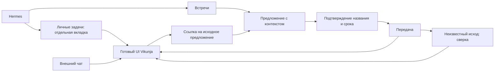
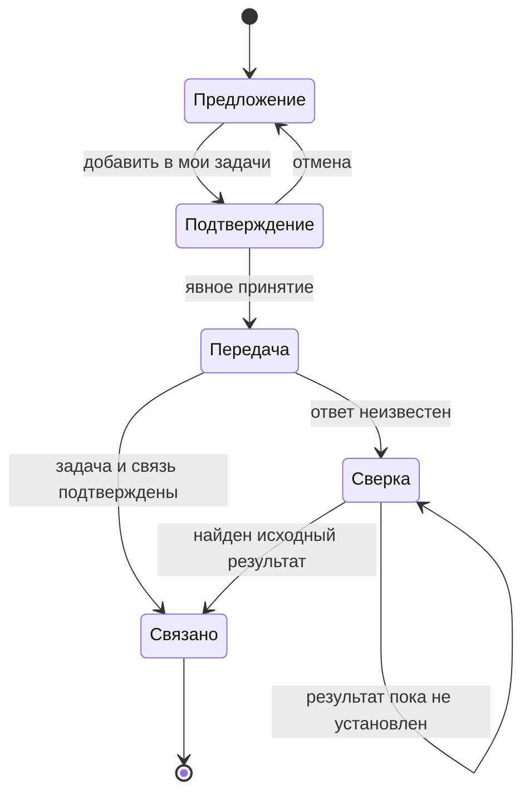

# EA-010 — макеты и переходы

**Редакция 0.1 · концептуальный черновик для ревью владельцем · 6 ноября 2026.**
Схемы ниже предлагают расположение интеграционных действий и тексты состояний. Это не снимки установленной Vikunja и не готовый Figma-прототип. Внутренний интерфейс Vikunja используется штатный; рисунки не задают его новую реализацию. Все названия задач и встреч в примерах синтетические.

## 1. Карта переходов



## 2. Переход к готовому трекеру

```text
Hermes
┌──────────────────────────────────────────────┐
│ Встречи       Личные задачи ↗     Development │
└──────────────────────────────────────────────┘
                 │ новая вкладка
                 ▼
┌──────────────────────────────────────────────┐
│ Vikunja — штатный интерфейс                  │
│ Проекты • Список / другие готовые виды       │
│ [Добавить задачу]                            │
│ ☐ Подготовить повестку      срок не задан    │
└──────────────────────────────────────────────┘
```

В Hermes не дублируются колонки и формы CRUD. Если готовый интерфейс требует входа, пользователь входит в него; недоступный сервис не выглядит пустым списком.

## 3. Предложение в существующих «Встречах»

```text
Из встречи: Планирование демонстрации
05.11.2026, 14:00–15:00 · Europe/Moscow
Обсуждали: подготовку синтетического стенда
Предлагается: подготовить повестку демонстрации
Тип: собственное обещание

[Точный фрагмент]  [Добавить в мои задачи]
[Уточнить]         [Отклонить]
```

Сохраняются текущие вкладки, даты и саммари «Встреч». Отметка прочтения не заменяет принятие. Кнопка передачи не должна мешать чтению источника.

## 4. Подтверждение передачи

```text
Добавить личную задачу в Vikunja?

Название
[Подготовить повестку демонстрации             ]
Срок
[                 ]  пусто: срок не задан
☐ Подтверждаю отсутствие срока

Источник: Планирование демонстрации
05.11.2026, 14:00–15:00 · Europe/Moscow
Краткий контекст и ссылка на предложение

[Отмена]             [Принять и передать]
```

Изначально основное действие недоступно до подтверждения срока/его отсутствия и непустого названия. При изменении срока подтверждение сбрасывается. Подсказка даты из речи отдельно помечается как неподтверждённая и не заполняет срок автоматически.

## 5. Результат и сбой

```text
Принято · передаём в Vikunja…
→ Передано в Vikunja · №<полученный ID>
  [Открыть задачу ↗] [Вернуться к предложению]

или
Принятие сохранено · результат передачи уточняется
[Проверить передачу]
```

Номер в угловых скобках — место для настоящего ответа API, не фиктивная созданная задача. При восстановлении используется прежняя операция. Повторное принятие или ручной повтор create не предлагается. Если задача найдена, но обратная связь потеряна, интерфейс показывает восстановление связи с тем же ID.



## 6. Чат

```text
Пользователь: Добавь личную задачу подготовить повестку.

После подтверждённой записи:
Задача создана: Подготовить повестку.
Срок: не задан. №<полученный ID>. [Открыть задачу]

Если результат ещё неизвестен:
Проверяю, сохранилась ли задача. Повторно не создаю.
```

При неоднозначном поиске чат показывает варианты с ID/названием и ожидает выбор до изменения. Относительная дата показывается абсолютной по Москве; неоднозначная уточняется. Действия над личной задачей не создают карточку Development.

## 7. Ревью

Проверить вместе с UX-спецификацией: понятен ли вход в трекер; достаточно ли контекста встречи; очевидно ли явное принятие; различаются ли доставка и выполнение; понятен ли следующий шаг после сбоя. Замечания вносятся через «Вернуть UI/UX с замечаниями». Принятие относится только к этой редакции черновиков; следующие этапы определяет зарегистрированный planner.

## Принятые источники и границы редакции

- `business-requirements`: `docs/artifacts/t_606468bd-business-requirements.md` · SHA256 `31648614925c5542f0b588d715586219fbe168b505452c802f0f663fcf344f9b`. Принятую версию этот черновик не меняет.
- `adr`: `docs/adr/t_606468bd-adr.md` · SHA256 `94d5da185d5ec617cb7b23214afd196f8aafe2a91d6eadb587cce6bc73ca6a85`. Принятую версию этот черновик не меняет.
- `nfr`: `docs/requirements/t_606468bd-nfr.md` · SHA256 `5bb23e0e741bf29eacee9cb5827e08218368d31441077cfa028682e6e9052dfc`. Принятую версию этот черновик не меняет.
- Поручение владельца 6 ноября: подготовить черновик по готовому UI Vikunja и трём сценариям интеграции для личного ревью. Локальные концептуальные схемы подготовлены по этому поручению; наличие Figma-макетов не заявляется.
