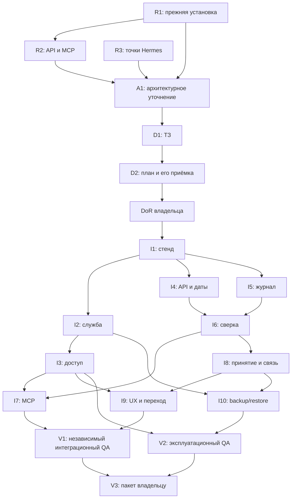

# EA-010 — декомпозиция и оценка задач

## 1. Паспорт и полномочия

| Поле | Значение |
| --- | --- |
| Редакция | 1.0 — локальный проект на review владельцу, не принято |
| Проект / процесс | `vikunja-local-ea010-install-integration` / `t_606468bd` |
| Поручение / шаг / роль | `t_d5dec478` / `decomposition` / `ai-developer` |
| Репозиторий / ветка | `vikunja-local` / наблюдаемая `hermes/install-vikunja-tracker` |
| Рабочая область | Назначенная worktree `install-vikunja-tracker`; новые worktree/ветки не создаются |
| Владелец приёмки | `iiefim10`: документы, implementation-plan и DoR — в Development; UAT/DoD — лично в Hermes |
| Выход этого поручения | Только `docs/tasks/t_606468bd-estimated-tasks.md`; без кода, обследования внешней среды, установки и публикации |

Это оценённый бэклог работ, **не implementation-plan и не разрешение выполнять перечисленные действия**. Здесь нет утверждённых команд, путей внешних изменений, календарных обещаний или согласования публикации. Пакеты ниже не созданы как Jira/Kanban-задачи и не назначены исполнителям; их ID — локальные обозначения документа. Декомпозиция документного шага не запускает дочерние реализации.

### Источники и проверенная редакция

Прочитана вся замороженная постановка, включая дополнительные указания владельца, публикацию и критерии готовности. Вычисленные SHA256 совпали с поручением:

| Источник | SHA256 |
| --- | --- |
| [Полная постановка](</Users/efimovivan/Documents/DevProjects/intake/vikunja-local-ea010-install-integration-task.md>) | `b5127175403c077884d3d1de00e445fd7cabbab13718024c00a4d1b4027b4165` |
| [Бизнес-требования](../artifacts/t_606468bd-business-requirements.md) | `31648614925c5542f0b588d715586219fbe168b505452c802f0f663fcf344f9b` |
| [ADR](../adr/t_606468bd-adr.md) | `94d5da185d5ec617cb7b23214afd196f8aafe2a91d6eadb587cce6bc73ca6a85` |
| [НФТ](../requirements/t_606468bd-nfr.md) | `5bb23e0e741bf29eacee9cb5827e08218368d31441077cfa028682e6e9052dfc` |
| [Макеты](../design/t_606468bd-mockups.md) | `eb413575640b276c8188d43b87fcb0f5c68c1a9421f5d7147cd7b823d43105a8` |
| [UX-спецификация](../design/t_606468bd-ux-spec.md) | `07b9da2d94890000f09391d90ff31387e75b636aaffe492f12bcbd6a1ac90966` |

Полномочие принятых входов — записи `approved` в [файле процесса](../process/t_606468bd.md), а не исторические подписи «черновик» внутри документов. `requirements-gate` имеет `passed`. Эти входы не редактируются. `epic.where: KIPL-2` — только существующая процессная ссылка: внешний эпик не прочитан, его содержание и приёмка не выдумываются.

Проверка `process-guard/process_plan.py next` с **`AI_PLATFORM_PROCESS_DIR=/Users/efimovivan/Projects/cto-agent-environment/ops/real/process-profile-staged`** вернула `decomposition`, `ai-developer`, `produces: [estimated-tasks]`, пустые `blocked_by`/`external_inputs`, отсутствие drift; recorded/current registry — `65dc5c6854ff`. Требования берутся из пересечения входов шага с типом задачи; отсутствие ТЗ на этом шаге не блокер. План процесса, записи приёмок и гейты этим документом не меняются.

Сверены инструкции AI Platform и роли `ai-developer`, навык `process-guard`, WS6 README, intake WORKFLOW/AGENTS и README сервиса. Текущая работа остаётся одним назначенным документным шагом.

## 2. Метод оценки и предел достоверности

- **Story points (SP)** — относительная сложность, объём проверок и риск; не часы/дни, не токены и не срок поставки. Скорость команды неизвестна, пересчёта в календарь нет.
- Шкала: **1** — локальная простая правка; **2** — небольшой известный сценарий; **3** — ограниченный компонент/исследование; **5** — несколько связанных состояний или интеграционная граница; **8** — самостоятельная межкомпонентная проверка с подготовкой и разбором результатов. Более крупный/неопределённый объём дробится заново.
- R1–R3 оценивают **ограниченное исследование и отчёт с выводом «поддерживается / не поддерживается / не установлено»**, а не гарантированное устранение обнаруженных проблем. Исследование заканчивается матрицей фактов/пробелов, а не бесконечной доводкой среды.
- A1/D1/D2 — оценка подготовки соответствующих документов по результатам исследований. Реализационные оценки I1–I10 — **условная база для совместимого reuse**, публичного API с доказуемой корреляцией и доступной узкой точки интеграции Hermes. Они не превращают неизвестные факты в подтверждённые возможности.
- Для I-пакетов включены реализация, собственные unit/integration-проверки по критериям и self-review. Независимые проверки по этапам, сквозной/эксплуатационный QA и финальная независимая сверка учитываются в V1/V2; инструкции и пакет передачи — V3. Исправления неизвестных дефектов и повторные циклы сверх согласованной базы не скрыты в «резерве».
- Несовместимая миграция, новый транспорт вместо принятого ADR, изменение чужой системы сверх узкого подключения или отсутствие безопасной корреляции **не оценены**. Это не нулевой объём: зависимые задачи останавливаются, результат передаётся владельцу/профильной роли для нового решения и переоценки. За пределами перечисленных пакетов задачи не создаются автоматически.
- Исследования и будущие тесты требуют отдельно разрешённой области/плана. Этот документ не разрешает чтение реальных задач, принятие предложений, пробные записи или перезапуск службы. Только явно помеченная синтетика; секреты и реальное содержимое не попадают в отчёты.

## 3. Исследования и подготовка до зависимой реализации

Предлагаемая ответственность ниже — функциональная, не фактический dispatch. Документы готовят профильные роли AI Platform; после необходимых гейтов в Orca координатор — Codex, реализация — Cursor, QA/review — отдельные Codex по политике flow. Выбор конкретных исполнителей и разрешения оформляются штатным процессом.

| ID / пакет | SP / достоверность | Зависимости и условия начала | Проверяемый результат / границы |
| --- | --- | --- | --- |
| **R1. Безопасная инвентаризация прежней установки** | **3**, ограниченный spike | Разрешённая read-only область обследования Mini; не выполняется этим поручением | Технический отчёт без содержимого: единственный экземпляр/отсутствие подтверждения, supervisor/runtime/версии, расположение и права БД/вложений/закрытой конфигурации/связей, признаки сохранности, конфликтов запуска и возможности копии/отката. Для каждого факта — источник проверки либо «не установлено». Ничего не удалять, не стартовать второй экземпляр и не менять рабочие данные. Основание для reuse, не само решение о миграции. BR-01/12/13/16, NFR-01/13/14. |
| **R2. Совместимость API, корреляции и MCP/Codex** | **5**, ограниченный spike | R1 для установленной версии; разрешённый изолированный синтетический стенд и план его cleanup для динамических проб | Матрица create/find/update/complete, полей происхождения/дат, полномочий и чтения результата; проверка корреляции **в атомарном create**, точной сверки и поведения после задержанного ответа. Проверка MCP stdio и запуска на Mini/через SSH из клиента, включая Codex. Не предполагать серверный idempotency key. Устойчивость корреляции к ручному изменению/удалению исследована либо явно ограничена. Отчёт с фактическими результатами, пробелами и cleanup; неподдержка BR-08/09 блокирует зависимую реализацию, а не маскируется HTTP retry. BR-03/08/09/11, NFR-02/03/06/07. |
| **R3. Точки подключения существующего Hermes** | **3**, ограниченный spike | Разрешение на read-only обследование конкретных внешних точек; их отсутствие — незакрытая зависимость | Найдены или явно не установлены: существующая авторизация явного принятия, стабильные ID/версии предложения и события, ссылки на встречу/предложение, место обратной ссылки, навигация «Личные задачи», конфигурация MCP-клиента. Таблица точных путей/владельцев/способов воспроизводимого применения и отката без изменения среды и вывода реальных встреч. Недоверенный `accepted=true` не принимается за авторизованное решение. BR-02/04/05/14/15, NFR-09/10/17. |
| **A1. Уточнение reuse и эксплуатационных ограничений** | **3**, условная | R1–R3; профильный архитектор и решения владельца по B2/B4 ниже | Новое согласуемое уточнение: reuse/безопасное дополнение либо необходимость отдельной миграции; runtime/supervisor, режим login/FileVault, маршрут/ссылки и права, согласованность копии/восстановления. Для несоответствия ADR — отдельное решение с приёмкой затронутой редакции до зависимых изменений, не молчаливое переписывание принятого входа. Миграция/реальная копия здесь не выполняются. BR-01/11–13, NFR-13–15, ADR OQ-01/02/05. |
| **D1. Системные требования и контракты** | **5**, условная | R1–R3, принятое A1 в затронутой части; шаг `system-analysis`, роль `ai-system-analyst` | ТЗ: методы/данные/ошибки API/MCP и локального JSON-интерфейса, доказательство принятия/версия, устойчивый ключ и окно повторов, долговечные состояния/блокировки, сверка и конфликты, безопасные update/complete, ссылки для двух устройств, MSK/опорное время/date-only и подтверждение срока, тестовые критерии и внешние точки. Непроверенные обязательные возможности не объявлять контрактом. Поведенческие пробелы адресуются владельцу; системные требования принимаются в предусмотренном маршруте. BR-03–11/14–16, NFR-05–12/16/17. |
| **D2. Точный implementation-plan и профиль проверок** | **3**, условная | Принятое D1 и `requirements-review-gate`; A1 и разрешения на внешние точки | Самодостаточные этапы с результатом, scope/исключениями, промптами, командами, критериями, context budget, commit message, точными branch/remote, применением/откатом внешних точек, окнами установки/рестарта, профилем стенда и cleanup. Включить независимые QA/review каждого этапа, итоговые проверки и публикацию только helper. План и затем DoR принимает `iiefim10`; этот пакет их не принимает. BR-15/17/18, NFR-17/18. |

**Порядок до DoR.** R1–R3 — работы для получения отсутствующих фактов, а не добавленные native шаги и не обход `development`. Где получить доказательства в разрешённом документном/исследовательском контуре, определяет ведущий flow. Read-only обследование и динамические пробы имеют разные полномочия. Если факты невозможно получить в разрешённой области, зависимые A1/D1/D2 не объявляются готовыми; профильная роль задаёт самодостаточный вопрос о доступе/плане исследования. Нельзя принять DoR по выдуманному контракту или начать код ради снятия отсутствующего входа.

## 4. Реализационные пакеты после ТЗ, плана и DoR

Общее условие начала **каждого** I-пакета: приняты применимые документы, точный implementation-plan и DoR; исследовательские блокеры сняты; этап разрешён координатором. Все I-оценки условны (§2). Пути/язык/схема БД/методы интерфейса здесь не выбираются вместо ТЗ. Существующий UI Vikunja не реализуется заново.

| ID / пакет | SP | Дополнительные зависимости | Проверяемый результат / исключения |
| --- | --- | --- | --- |
| **I1. Воспроизводимый синтетический стенд и проверки** | **3** | D2; проверенная версия из R2 | Реальные локальные зависимости по профилю, readiness/smoke, fixtures с префиксом/ID прогона, изолированные данные/порты. Cleanup в finally после успеха/ошибки и read-back отсутствия собственных ресурсов; сверка после аварии хоста. Не останавливает рабочую службу/чужие процессы. Mock-тесты не подменяют E2E. BR-16/17, NFR-04/18. |
| **I2. Воспроизводимая установка/reuse и жизненный цикл** | **5** | A1, I1; согласованные защищённая копия/откат до изменения рабочей установки | Код установки/конфигурационные шаблоны и управление единственной службой в `vikunja-local`; постоянные данные и закрытая конфигурация на Mini вне Git. Повтор применения не создаёт второй управляющий контур. Автозапуск и диагностика в согласованном режиме macOS; запуск до login не обещается без проверки. Никакой несовместимой миграции в этой оценке. BR-01/12/13/15, NFR-01/13/14. |
| **I3. Защищённый доступ и адреса двух устройств** | **3** | I2; согласованные SSH/права/адреса из R1–R3/A1 | Loopback Mini, аутентифицированный SSH-туннель с MacBook по ADR; права приложения поверх туннеля. Настроены и проверены ссылки на один экземпляр/ID, origin/cookie/CSRF и отказ неавторизованному клиенту. Токен остаётся на Mini, без секретов в argv/логах. Нет публичного listener, LAN HTTP и ослабления защиты. BR-11/16, NFR-02/03/10. |
| **I4. Общий API-клиент, CRUD, даты и подтверждение результата** | **5** | I1, R2, D1 | Create/find/update/complete через поддерживаемый API, без прямой записи в БД. Чтение записанного объекта перед успехом, фактические ID и ссылки; актуальный статус только из Vikunja. Неоднозначный поиск требует выбора; безопасное обновление не затирает более новое ручное изменение. Пустой/подтверждённый срок, MSK, опорное время/date-only и граница суток по ТЗ. Это внутренний слой: интеграционные writes не включаются в обход I5/I6. BR-03/06/09/10, NFR-05/07/10/11. |
| **I5. Долговечные операции и связи** | **5** | I1, D1, R2 | Журнал намерений и соответствий на Mini до внешней записи; устойчивый ключ одной операции, разные ключи разных намерений при одинаковом названии, координация конкурентных повторов и восстановление после рестарта. Недоступный/повреждённый журнал запрещает write; память процесса не заменяет долговечность. Журнал не хранит конкурирующий актуальный статус задач; retention не уничтожает ещё действующие ключи повтора. BR-06/08/09, NFR-01/05–08. |
| **I6. Сверка неопределённых исходов и восстановление** | **5** | I4, I5; положительный результат R2 по корреляции | При таймауте/позднем ответе сначала сверка: одно совпадение возвращает прежний ID; несколько — конфликт; ноль при возможной незавершённой записи не разрешает create. После сбоя между записью/журналом/обратной ссылкой восстанавливается только недостающее соответствие. Удалённый/недоступный объект не пересоздаётся автоматически. Диагностика без содержимого, отсутствие ложного успеха и слепых retry. BR-08/09/17, NFR-06–08/16. |
| **I7. MCP внешнего чата, включая Codex** | **3** | I3–I6; проверенный запуск клиента из R2 | MCP stdio/JSON-RPC на Mini, SSH-вызов с MacBook по ADR; четыре операции на общем адаптере, устойчивый ключ сохраняется при повторе транспорта без ручного ввода пользователем. Ответы различают успех с ID/ссылкой, нет совпадений, выбор, доступ/недоступность, неопределённость/конфликт. Никаких development-вызовов или запуска нового coding-agent для личного CRUD. BR-03/06–11, NFR-02/05–07/11/12/16. |
| **I8. Авторизованная передача предложения и возвратная связь** | **5** | I4–I6; R3, разрешённая внешняя точка по D2 | Узкий мост существующего принятия Hermes → локальный интерфейс общего адаптера. Проверяются полномочия, стабильный источник/версия и факт явного принятия. Передаются название, ссылка, название/время встречи, краткий подтверждённый контекст, подтверждённый/пустой срок; не расшифровка. Повтор возвращает прежнюю задачу, потерянная ссылка восстанавливается без нового принятия/create. До принятия и при поддельном `accepted=true` задачи нет. Код/патч/способ применения и отката — в `vikunja-local`; внешние изменения только по точному плану. BR-04/05/08–10/13–16, NFR-08–12/17. |
| **I9. Навигация и минимальные UX-состояния Hermes** | **5** | I3, I8; принятые макеты/UX и точки D2 | «Личные задачи ↗» открывает готовую Vikunja отдельно, без копии списка. В существующем предложении — подтверждение названия/срока либо его отсутствия; изменение срока сбрасывает подтверждение; проверяется версия источника. Отмена ничего не передаёт. Принятие, доставка и выполнение различимы; busy/повторное открытие не создают операцию; понятные сверка, восстановление связи и ошибки. Клавиатура, фокус/Escape/возврат фокуса, подписи не только цветом, перенос текста и экран 390 px. Не редизайн «Встреч». BR-02/04/05/09/10/14, NFR-09–11/17. |
| **I10. Backup/restore и безопасное восстановление интеграции** | **5** | I2, I5, I6, I8; согласованные B4 и окно операций | Воспроизводимая согласованная копия БД/вложений/закрытой конфигурации/журнала/связей, инструкции диагностики и restore. Реальная проба синтетического контура в изоляции; записи после restore возобновляются только после сверки с Vikunja, старые неопределённые операции не дают дубль. Рабочие данные не перезаписываются ради теста. Частота/retention/RPO/RTO и носитель не придуманы; копия на Mini не объявляется защитой от его физической потери. BR-09/12/13/17, NFR-13–16. |

## 5. Независимая проверка и передача

| ID / пакет | SP / достоверность | Зависимости | Проверяемый результат |
| --- | --- | --- | --- |
| **V1. Независимые review/QA этапов и интеграционная проверка** | **8**, условная база | Для каждого этапа — его завершённый I-пакет и точный SHA; итог — I1–I9 | Отдельные от автора review/QA по этапам до их публикации; замечания и результаты привязаны к редакции. Реальные E2E: UI → чат и чат → UI, CRUD из Codex, явное принятие синтетического предложения владельцем → задача с обеими ссылками, отказ без принятия, повтор/конкурентный повтор, таймаут после записи/поздний ответ, сбои фиксации журнала/ссылки. Проверки дат, ручного изменения/удаления, конфликтного/пустого поиска, прав/отозванного токена/недоверенного принятия, UX/390 px. Подтверждены единый статус и отсутствие development-run, регресс существующих «Встреч» без вывода реальных данных; cleanup после каждого прогона. Независимое code review дополнительно проверяет все I-пакеты, включая эксплуатационный код I10. BR-02–11/14–18, NFR-02–12/16–18. |
| **V2. Независимая эксплуатационная проверка** | **5**, условная база | I2, I3, I10; разрешённое окно рестарта и доступ к обоим устройствам | Проверка собственной службы/локальности/отсутствия второго экземпляра; рестарт Mini и автозапуск в согласованном режиме; сохранение синтетических ID/вложения/журнала/связей. Изолированный restore, повтор после старой копии, восстановление связи. Проверка Mini/MacBook-ссылок, bind/прав, отсутствия утечек и сохранности исходной среды по разрешённым метаданным. Замеры MET-01–07 в согласованном профиле, без вымышленных порогов; обязательные проверки не засчитываются как skip. SHA, команды, результаты и cleanup, включая ошибки. BR-01/11–13/16/17, NFR-01–04/13–18. |
| **V3. Проверенные инструкции и пакет владельцу** | **3**, условная база | V1, V2; для release notes — соответствующий native шаг после предусмотренных приёмок | Проверенные инструкции трёх каналов, службы, диагностики, backup/restore и восстановления связи; локально переданные проверенные адреса Mini/MacBook, SHA и независимые результаты/cleanup/ограничения. Закрытая топология и секреты не публикуются; общедоступная часть обезличена. Материалы для отдельного подтверждения итогового GitHub PR и личных UAT/DoD; release-docs по native плану. Сам пакет не принимает UAT/DoD и не объявляет процесс закрытым. BR-17/18, NFR-18. |

V1/V2 — планируемый объём проверок, не отчёты о прохождении. Независимые проверки отдельного этапа выполняются до перехода к следующему этапу; V1 не откладывает их до финала. Эксплуатационный этап I10 также получает независимые QA/review до commit/push, а V2 даёт его функциональные доказательства. Дефекты возвращаются в исходный scope с повторной независимой проверкой исправленного SHA. Новые требования/неизвестные дефекты оцениваются явно, без самовольного расширения задачи.

## 6. Зависимости и предлагаемая группировка

Табличные зависимости — источник порядка. Это DAG работ, **не новая последовательность native шагов**, не календарный критический путь и не поручение запускать агентов параллельно.

Возможная группировка для будущего implementation-plan: **S1** стенд I1; **S2** единственная служба/доступ I2–I3; **S3** API/долговечность/сверка I4–I6; **S4** чат I7; **S5** узкий мост/UX I8–I9; **S6** backup/restore I10; затем итоговые V1/V2 и пакет V3. Это предложение, не принятые этапы. Слишком большой S3/S5 должен быть разбит в D2 на самостоятельно проверяемые части; инфраструктурные заготовки не включают writes до готовности защит. Каждая часть получает собственные независимые QA/review, SHA и cleanup.

В D2 фиксируются exact scope, самодостаточный промпт, команды/критерии, commit message и контекст каждого этапа (ориентир до 200–300 тыс. токенов, без пересчёта SP в токены). Документные пакеты A1/D1/D2 не подменяются стадиями кода. Если исследования требуют отдельного разрешения, его получают до исследований, а не считают выданным будущим DoR.

## 7. Внешние зависимости и блокеры

Эти зависимости **не блокируют подготовку декомпозиции**, поскольку неопределённая часть отделена в R-пакеты. Они блокируют названные ниже действия до фактического разрешения. Отсутствие доступа не даёт права исследовать чужую среду; следующий исполнитель задаёт вопрос по протоколу flow, а не придумывает документ.

| ID | Что отсутствует / кто разрешает | Блокируемая работа и требуемое свидетельство |
| --- | --- | --- |
| **B1** | Факты прежней установки и разрешённая область — владелец/ведущий flow, R1 | A1 и любые установка/остановка/рестарт. Нужны безопасная inventory, мотивированный reuse и подтверждённый план сохранения; нельзя считать данные пустыми или запускать второй экземпляр. |
| **B2** | Поддержка обязательных свойств API/MCP — R2; при несовместимости архитектор/владелец | D1 в зависимой части, I4–I8 и обещание BR-08/09. Нужны реальные синтетические доказательства корреляции/сверки и клиента; неподдержка требует решения/переоценки, не перехода к варианту прямых writers. |
| **B3** | Точные точки Hermes, доказательство принятия, воспроизводимое применение/откат — R3 и владелец внешней среды | D1/D2, I8/I9; также подключение MCP I7. Код/патчи принадлежат `vikunja-local`; чужие файлы меняются только в отдельно принятой области. Неизвестная интеграционная точка не заменяется прямой записью в БД. |
| **B4** | Эксплуатационные решения — `iiefim10` при поддержке профильных ролей | A1/D2 в нужной части, I2/I10/V2: режим login/FileVault/сна, права и защищённый маршрут; backup interval/retention/носитель/согласованность, RPO/RTO, нагрузочный профиль/SLO/ресурсный бюджет и окно повторов MET-01–07. Число или явно согласованный режим без числового SLO фиксируется до зависимой приёмки. Незаданный порог не означает пройденную проверку. |
| **B5** | Приёмки ТЗ, implementation-plan, DoR — лично владелец | Все I-пакеты и Orca-реализация. Требуются актуальные версии, предусмотренные гейты и точный перечень внешних воздействий. Принятие этой декомпозиции не разрешает код или установку. |
| **B6** | Авторизованный доступ Mini/MacBook, окно рестарта/проб и явное принятие **синтетического** предложения владельцем | Динамическая часть R2, проверки V1/V2 и рабочее применение. Нет устройства/полномочий — результат «не проверено», не фиктивные ID/ссылки. Реальное предложение не используется как fixture. |
| **B7** | Точный publication plan и полномочия helper, финальный PR — владелец | Любой commit/push этапа требует принятого exact branch/remote-плана и независимых проверок; выполняет только coordinator helper. Итоговый GitHub PR отдельно подтверждается после итоговых проверок. Force push/merge не разрешены. Наблюдаемая ветка и SSH remote из постановки не являются этой приёмкой. |

Обнаруженные несовместимая миграция, отсутствие корреляции, необходимость расширить UI/чужую систему или иной scope-change передаются профильной роли и владельцу **до** зависимых изменений. Их стоимость и новая дата поставки здесь не выдуманы; SP пересматриваются после фактов. Решение на вопрос не принимается за приёмку документа.

## 8. Трассировка обязательного результата

Номера BR/AC относятся к принятым БТ; каждый указанный BR проверяется его одноимённым AC. Требования не объявляются выполненными наличием строки в таблице.

| BR / AC | Пакеты реализации/подготовки | Независимое свидетельство |
| --- | --- | --- |
| 01 — собственная служба/локальность | R1, A1, I2, I10 | V2: размещение, свой экземпляр, синтетика/вложение |
| 02 — готовый UI и вход из Hermes | R3, I3, I9 | V1/V2: переход, CRUD UI, Mini/MacBook |
| 03 — CRUD чата с ID/ссылкой | R2, D1, I4–I7 | V1: фактические четыре операции, сверка UI |
| 04 — только явное принятие | R3, D1, I8/I9 | V1: негативы и принятие синтетики владельцем |
| 05 — происхождение и обе ссылки | R3, I4, I8/I9 | V1/V2: поля и переходы на тот же ID |
| 06 — единый актуальный статус | D1, I4–I8 | V1: UI ↔ чат, недоступность не равна актуальному кешу |
| 07 — без dev-flow/coding-agent | D1, I7/I8 | V1: отсутствие development/run/dispatch |
| 08 — повтор без дубля | R2, D1, I5–I8 | V1/V2: повтор, конкурентность, рестарт/restore |
| 09 — таймаут/частичный сбой | R2, I4–I6, I8, I10 | V1/V2: поздняя запись, потери журнала/ссылки, прежний ID |
| 10 — сроки/MSK | D1, I4, I7–I9 | V1: пустой/неоднозначный срок, граница суток/date-only |
| 11 — защищённый доступ | R1/R2, A1, I3/I7 | V1/V2: два устройства, негативные права/bind |
| 12 — автозапуск/сохранность | R1, A1, I2/I10 | V2: согласованный рестарт, прежние ID/вложение/связи |
| 13 — сохранить подготовку и данные | R1/R3, A1, I2/I8/I10 | V1/V2: reuse, изоляция, сохранность метаданных/регресс |
| 14 — узкая интеграция «Встреч» | R3, D1, I8/I9 | V1: независимый review scope, регресс и UX |
| 15 — воспроизводимость в репозитории | R3, D2, I1–I10 | V1/V2: diff, точные внешние точки/откат, команды |
| 16 — секреты/реальные данные | Все пакеты | V1/V2: синтетика, проверка diff/логов/прав без вывода секретов |
| 17 — проверки/cleanup/инструкции | D2, I1/I6/I10, V1–V3 | SHA, результаты, проверенный cleanup каждого прогона, инструкции |
| 18 — согласования/поставка | D2, V1–V3; весь native flow | Решения владельца точных редакций, receipts helper и отдельного PR, личные UAT/DoD и штатное закрытие |

Все NFR-01–18 распределены по карточкам пакетов; MET-01–07 — решения B4 и измерения V2, не новые придуманные целевые значения. Дополнительные UX-критерии (подтверждение срока, версия источника, доступность и 390 px) покрывают I9/V1. Нормативное описание поведения остаётся в принятых входах и будущем ТЗ, не заменяется этой трассировкой.

## 9. Итог оценки и порядок передачи

<!-- estimate-summary: проверить сумму инструментом при изменении SP -->
Исследования R1–R3: **11 SP**. Документы A1/D1/D2: **11 SP**. Реализация I1–I10: **44 SP**. Независимые проверки и передача V1–V3: **16 SP**. Всего перечислено **19 пакетов, 82 SP условной базы**.

Это не полная фиксированная стоимость при любом исходе исследований и не срок. Достоверность R-пакетов относится к границе исследования; оценки зависимой реализации и проверок — предварительные до R1–R3, ТЗ и exact implementation-plan. В сумму не включены неограниченная миграция, замена архитектурного паттерна, неизвестная доработка внешней системы, время ожидания доступов/ответов/приёмок и неоценённые дефекты. Календарный критический путь без этих данных не рассчитан.

После принятия этой редакции следующий шаг определяет native planner, ожидаемый по текущему состоянию — `system-analysis`; A1/R-пакеты описывают необходимые работы по снятию неизвестного, но не меняют native план. Затем — предусмотренные review требований, implementation-planning, личная приёмка плана и DoR. Реализация только после согласований, через Hermes → AI Platform → Orca, с независимыми QA/review **каждого** этапа. Разработчики сами не публикуют: stage commit/обычный push выполняет только coordinator helper по принятому exact branch/remote-плану. Текущий документный worker ничего не коммитит/не пушит.

Итоговый GitHub PR требует отдельного подтверждения после всех этапов и финальных проверок; внутренние Orca QA/review не заменяют формальные шаги native плана. Дальнейшие code review, functional-testing, defects-gate, UAT, DoD и release-docs выполняются по его актуальному состоянию. Установка/запуск собственной службы входит в целевой результат, но не разрешается одной приёмкой оценок. Нет автоматических приёмок, merge/deploy или переноса старых гейтов; UAT/DoD лично принимает владелец в Hermes, закрытие объявляется только после подтверждённого штатного завершения.

**Состояние сдачи:** подготовлен только этот документ на review; исследования, реализация, сервисные тесты и эксплуатационные действия здесь не выполнялись. Службы, реальные предложения, принятые документы, process-state и гейты не изменялись. Передача на review не является самоприёмкой и не завершает общую EA-010.
